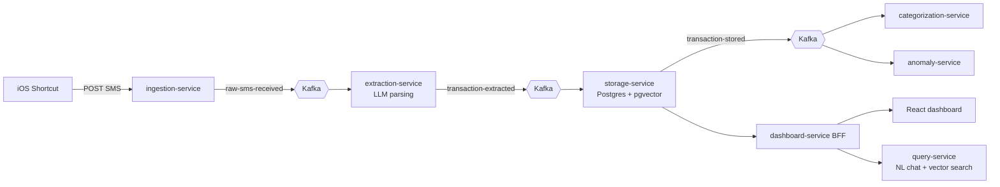

<div align="center">

[](https://github.com/ravagerahul)

<a href="https://www.linkedin.com/in/rahulwalia2/"></a>
<a href="mailto:riitwalia38@gmail.com"></a>


</div>

---

## `~/about.sh`

```java
public class Rahul extends FullStackDeveloper implements BackendEngineer {

    String   location   = "India";
    String[] coreStack  = { "Java 17", "Spring Boot 3", "Kafka", "PostgreSQL", "AWS" };
    String[] frontend   = { "React", "TypeScript", "JavaScript" };
    String[] devops     = { "Docker", "Kubernetes", "Jenkins", "Caddy" };

    String currentlyBuilding = "SpendSense AI - SMS -> Kafka -> LLM -> Postgres pipeline";
    String currentlyLearning = "Golang, distributed systems, RAG";
    String funFact           = "I solve DSA problems daily in C++";

    public boolean openToWork() { return true; }
}
```

## ⚡ Flagship Project: SpendSense AI

> Turns the bank SMS that already lands on your phone into a **categorized, queryable spending history**. UPI apps expose no API, so the SMS is the one reliable channel.



| | |
|---|---|
| 🏗️ **Architecture** | 8 Spring Boot microservices in a Gradle multi-module build, communicating over Kafka |
| 🧠 **AI** | LLM extracts amount, merchant, direction and date from raw SMS; embeddings in **pgvector** power natural-language chat |
| 🔒 **Privacy** | Account balances are masked before text ever reaches the model |
| 🛡️ **Reliability** | Correlation IDs trace each message end to end; 3 failed attempts route to a dead-letter topic instead of losing data |
| 🚢 **Deploy** | Docker Compose with Caddy as the single entry point |
| 📦 **Codebase** | ~150k lines of Java, ~65k of TypeScript |

[](https://github.com/ravagerahul/SpendSense-AI-Event-Driven-Personal-Finance-Intelligence-Platform)

## 🛠️ Tech Arsenal

<div align="center">


</div>

## 📂 More Projects

| Project | Description | Stack |
|---|---|---|
| [🧬 **GPS Dementia Patient Monitoring**](https://github.com/ravagerahul/GPS-based-Alzheimer-dementia-patientmonitoring-system) | Real-time GPS tracking system to monitor Alzheimer's and dementia patients | `Java` |
| [🧮 **DSA**](https://github.com/ravagerahul/DSA) | Daily data structures and algorithms practice | `C++` |
| [📚 **Library Management System**](https://github.com/ravagerahul/library-management-system) | Web app to manage books and members | `HTML` |
| [✅ **Todo App**](https://github.com/ravagerahul/todo-app) | Task manager with a clean UI | `JavaScript` |

## 📊 GitHub Analytics

<div align="center">


</div>

## 🤝 Let's Build Something

I'm looking for backend and full stack roles where I can work on distributed, event-driven systems. If you're hiring or want to collaborate, reach out on [LinkedIn](https://www.linkedin.com/in/rahulwalia2/) or [email me](mailto:riitwalia38@gmail.com).


